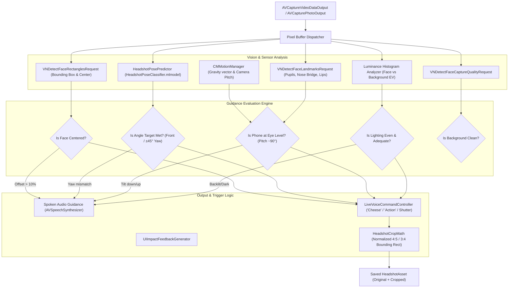
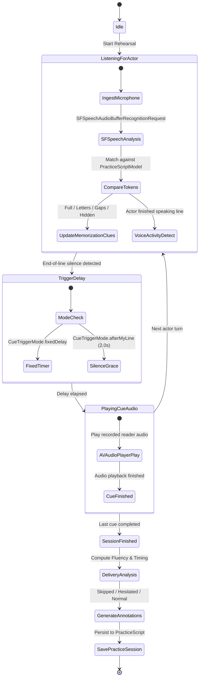
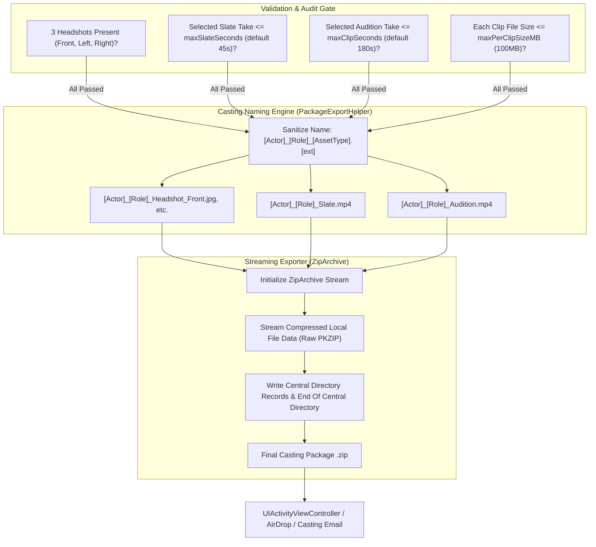
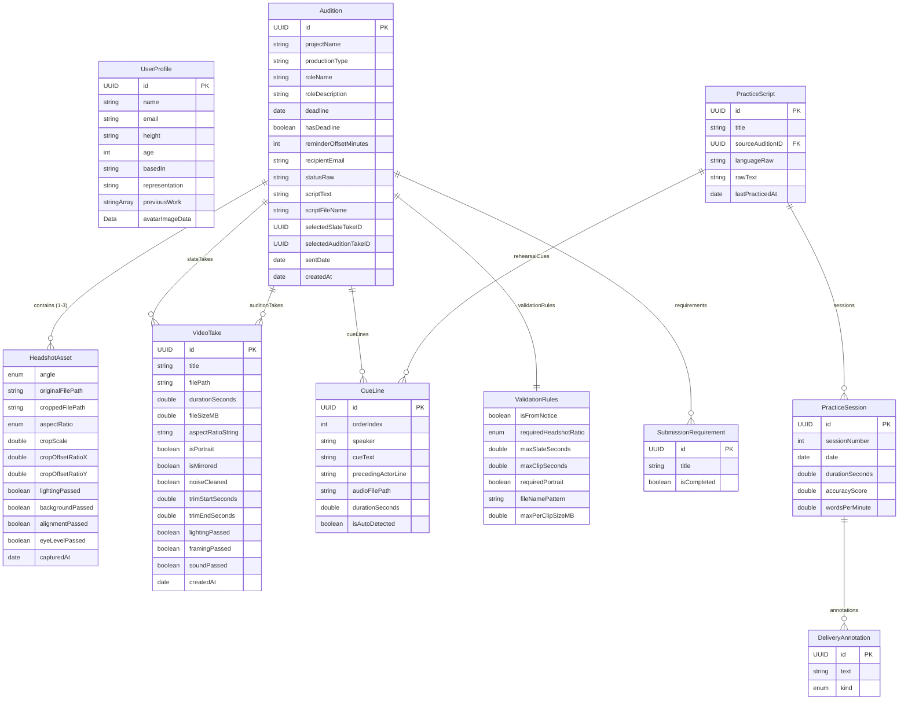
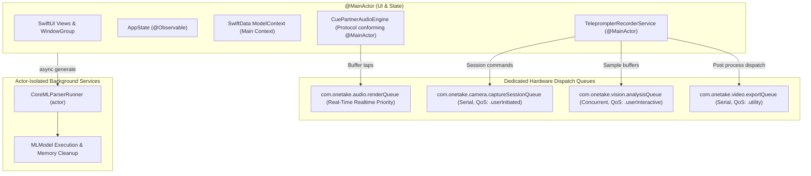

# OneTake — Low-Level Architecture & Technical Specification

> **Platform**: iOS 18.0+ / iPadOS 18.0+  
> **Language & Runtime**: Swift 5.0 / Swift 6 Strict Concurrency  
> **Architecture Style**: Unidirectional State & Actor-Isolated Service Pipelines  
> **Primary Frameworks**: SwiftUI, SwiftData, AVFoundation, Vision, CoreML, Accelerate, Speech, CoreMotion  

---

## 1. System Overview & Technology Stack

OneTake is a native, offline-first iOS audition and self-tape studio designed for actors and performers. It integrates real-time camera capture, voice-driven automation, on-device machine learning (Apple Neural Engine), computer vision headshot framing, audio cue partners, post-processing video compression, and casting submission packaging.

```
+---------------------------------------------------------------------------------------+
|                                    PRESENTATION LAYER                                 |
|   SwiftUI Views | Glassmorphic Design System | Navigation TabView | Modal Sheets      |
+---------------------------------------------------------------------------------------+
                                           |
                                           v
+---------------------------------------------------------------------------------------+
|                                DOMAIN & STATE LAYER                                   |
|   AppState (@Observable @MainActor) | SwiftData ModelContext | ModelContainer         |
+---------------------------------------------------------------------------------------+
        |                         |                         |                     |
        v                         v                         v                     v
+---------------+         +---------------+         +---------------+     +-------------+
|    CAMERA &   |         |  INTELLIGENCE |         |    AUDIO &    |     |  EXPORT &   |
|   RECORDING   |         |   & VISION    |         |   PRACTICE    |     |   STORAGE   |
| Teleprompter- |         | OneTakeParser |         | Practice-     |     | ZipArchive  |
|  Recorder     |         |  (ANE / Qwen) |         |  Pipeline     |     | Validation- |
| PostProcess-  |         | HeadshotGuide |         | CuePartner-   |     |  Rules      |
|  Service      |         | NoticeOCR     |         |  AudioEngine  |     | MediaStorage|
+---------------+         +---------------+         +---------------+     +-------------+
```

---

## 2. Full Low-Level Architecture Diagram

```mermaid
flowchart TD
    subgraph UI["Presentation Layer (SwiftUI + @Observable)"]
        Root["OneTakeApp / RootContentView"]
        AppState["AppState (@Observable @MainActor)"]
        
        subgraph Tabs["App Tabs & Views"]
            AuditionsView["AuditionsListView"]
            AuditionHub["AuditionPackageHubView"]
            AuditDetail["AuditionDetailsEditorView"]
            TeleView["TeleprompterRecorderView"]
            ReviewView["TakeReviewView"]
            HeadshotGuide["HeadshotGuidanceView"]
            HeadshotCrop["HeadshotCropView"]
            PracticeFlow["PracticeFlowView"]
            PracticeHub["PracticeHubView"]
            ExportView["PackageValidationAndExportView"]
            DocScanner["DocumentScannerRepresentable"]
        end
    end

    subgraph Domain["Domain & Persistence Layer (SwiftData)"]
        ModelContainer["SwiftData ModelContainer"]
        UserProfile["UserProfile (@Model)"]
        Audition["Audition (@Model)"]
        PracticeScript["PracticeScript (@Model)"]
        MediaStorage["MediaStorage (Relative File Path Resolver)"]
    end

    subgraph CV_ML["Vision & On-Device ML Layer"]
        NoticeOCR["NoticeOCR (Vision Text Recognition)"]
        PDFGeo["PDFGeometryExtractor (PDFKit)"]
        LayoutRec["OCRLayoutReconstructor (Spatial Clustering)"]
        CastingParser["CastingCallParserService (Deterministic Regex + Rules)"]
        OnDevIntel["OnDeviceIntelligence (Grounding Filter)"]
        ParserRunner["CoreMLParserRunner (Actor Isolated)"]
        BPETokenizer["BPETokenizer (Pure Swift BPE)"]
        ModelANE["OneTakeParserANE.mlpackage (0.5B ANE/CPU)"]
        VocabFiles["vocab.json & merges.txt (151k Tokens)"]
        HeadshotGuideSvc["HeadshotGuidanceService"]
        PosePredictor["HeadshotPosePredictor (HeadshotPoseClassifier.mlmodel)"]
        VisionFace["Vision (VNDetectFaceLandmarks / Quality)"]
    end

    subgraph AV_Engines["Audio, Video & Sensor Hardware Engines"]
        TeleService["TeleprompterRecorderService"]
        AVCam["AVCaptureSession (4K/1080p, Front/Back)"]
        VoiceCmdCtrl["LiveVoiceCommandController ('Action', 'Cut')"]
        VoiceTracker["VoiceTeleprompterTracker (SFSpeechRecognizer)"]
        MotionMgr["CMMotionManager (Pitch, Roll, Eye-Level Tilt)"]
        PostProcSvc["VideoPostProcessingService"]
        SilenceTrim["SilenceTrimmer (vDSP Accelerate Audio Energy)"]
        AVComp["AVMutableComposition & AVAssetExportSession"]
        CueAudioEng["CuePartnerAudioEngine (AVAudioEngine + VAD)"]
        PracticePipeline["PracticeSpeechPipeline (Delivery Analysis)"]
    end

    subgraph Export_Eng["Validation & Archiving Engine"]
        ValRules["ValidationRules (3 Ratios, Duration, Size)"]
        ExportHelper["PackageExportHelper (Naming Standard)"]
        ZipStream["ZipArchive (Pure Swift Streaming PKZIP)"]
    end

    %% Connections
    Root --> AppState
    AppState --> ModelContainer
    ModelContainer --> UserProfile
    ModelContainer --> Audition
    ModelContainer --> PracticeScript

    AuditionsView --> AppState
    AuditionHub --> AppState
    TeleView --> TeleService
    ReviewView --> PostProcSvc
    HeadshotGuide --> HeadshotGuideSvc
    HeadshotCrop --> MediaStorage
    PracticeFlow --> PracticePipeline
    PracticeFlow --> CueAudioEng
    ExportView --> ValRules
    ExportView --> ExportHelper
    ExportHelper --> ZipStream

    %% OCR and Parsing Flow
    DocScanner --> NoticeOCR
    NoticeOCR --> LayoutRec
    PDFGeo --> LayoutRec
    LayoutRec --> CastingParser
    CastingParser --> OnDevIntel
    OnDevIntel --> ParserRunner
    ParserRunner --> BPETokenizer
    BPETokenizer --> VocabFiles
    ParserRunner --> ModelANE
    OnDevIntel --> Audition

    %% Camera & Recording Flow
    TeleService --> AVCam
    TeleService --> MotionMgr
    TeleService --> VoiceCmdCtrl
    TeleService --> VoiceTracker
    VoiceCmdCtrl --> TeleService
    TeleService --> PostProcSvc
    PostProcSvc --> SilenceTrim
    PostProcSvc --> AVComp
    PostProcSvc --> MediaStorage

    %% Headshot Guidance Flow
    HeadshotGuideSvc --> AVCam
    HeadshotGuideSvc --> MotionMgr
    HeadshotGuideSvc --> VisionFace
    HeadshotGuideSvc --> PosePredictor
    HeadshotGuideSvc --> VoiceCmdCtrl
    HeadshotGuideSvc --> MediaStorage

    %% Audio & Practice Flow
    CueAudioEng --> PracticePipeline
    PracticePipeline --> PracticeScript

    %% Storage resolution
    Audition --> MediaStorage
    PracticeScript --> MediaStorage
    ExportHelper --> MediaStorage
```



---

## 3. Subsystem Architecture & Execution Workflows

### Subsystem A: Document OCR & Offline Neural Notice Parser Pipeline

Extracts casting breakdowns, sides, and audition notices directly into structured SwiftData entities without external network dependencies.

```mermaid
sequenceDiagram
    autonumber
    actor Actor as Performer
    participant Cam as VNDocumentCamera / PDFKit
    participant OCR as NoticeOCR / PDFGeometryExtractor
    participant Layout as OCRLayoutReconstructor
    participant Rule as CastingCallParserService
    participant Intel as OnDeviceIntelligence
    participant Runner as CoreMLParserRunner (Actor)
    participant BPE as BPETokenizer
    participant ANE as OneTakeParserANE (CoreML)
    participant DB as Audition (SwiftData)

    Actor->>Cam: Scan Paper Notice / Import PDF
    Cam->>OCR: Deliver Document Images / PDF Pages
    OCR->>OCR: Vision VNRecognizeTextRequest (.accurate)
    OCR->>Layout: Raw recognized lines & bounding boxes
    Layout->>Layout: Spatial geometric clustering into lines & blocks
    Layout->>Rule: Reconstructed text string
    Rule->>Rule: Regex heuristics (Project, Role, Deadline, Email)
    alt Missing essential fields (Project, Role, Email, Deadline)
        Rule->>Intel: refineParsedCall(parsed, sourceText)
        Intel->>Runner: generate(systemPrompt, userPrompt)
        Runner->>Runner: Check RAM >= 5 GB (Jetsam Safety Guard)
        Runner->>BPE: encode(promptText)
        BPE->>BPE: BPE ranking via merges.txt & vocab.json
        BPE-->>Runner: input_ids tensor [1, S]
        Runner->>ANE: Predict next-token logits on Apple Neural Engine
        ANE-->>Runner: Output logits [1, 1, 151936]
        Runner->>BPE: decode(tokenIDs)
        BPE-->>Runner: JSON string
        Runner-->>Intel: Extracted JSON output
        Intel->>Intel: Source Grounding: verify values exist in original OCR text
        Intel-->>Rule: Refined GroundedNoticeFields
    end
    Rule->>DB: Populate Audition entity (Project, Role, Deadline, Requirements)
    DB-->>Actor: Present structured Audition in Editor View
```

#### Low-Level Notice Parser Implementation Details
1. **Memory & Jetsam Protection**: `CoreMLParserRunner.supportsInProcessParserModel` checks `ProcessInfo.processInfo.physicalMemory >= 5_000_000_000`. On devices with $\le$ 4 GB RAM (such as iPhone 11) or iOS Simulator, the 0.5B neural weights are skipped to avoid Jetsam memory limit terminations (~1.4 GB ceiling).
2. **Deterministic Source Grounding**: `OnDeviceIntelligence.isGroundedNoticeValue` ensures hallucinated entities from generative models are rejected; all tokens must exist verbatim or case-insensitively in OCR source text.
3. **Pure Swift BPE**: `BPETokenizer` parses UTF-8 byte mappings and merges without Python or external C++ libraries.

---

### Subsystem B: Real-Time Teleprompter & Video Capture Engine

Executes hands-free video recording with automated voice commands, speech-driven teleprompter scrolling, and camera sensor stabilization.

```mermaid
sequenceDiagram
    autonumber
    actor Actor as Performer
    participant UI as TeleprompterRecorderView
    participant Svc as TeleprompterRecorderService
    participant AVCam as AVCaptureSession
    participant Motion as CMMotionManager
    participant Voice as LiveVoiceCommandController
    participant Tracker as VoiceTeleprompterTracker
    participant Post as VideoPostProcessingService

    Actor->>UI: Open Teleprompter Recording
    UI->>Svc: startSession()
    Svc->>AVCam: Configure 1080p/4K @ 24/30fps, Front/Back Input
    Svc->>Motion: Start Device Motion Updates (Pitch/Roll)
    Svc->>Svc: Pre-take checks (Lighting, Background, Eye Level, Tilt)
    Svc-->>UI: Real-time PreTakeQualityMetrics updates

    Actor->>Svc: Speaks: "How do I look?"
    Svc->>Voice: handleRecognizedTranscript("how do i look", isFinal: false)
    Voice->>Svc: speakFramingFeedback()
    Svc-->>Actor: AVSpeechSynthesizer audio cue: "Tilt up slightly"

    Actor->>Svc: Speaks: "Action!"
    Svc->>Voice: handleRecognizedTranscript("action", isFinal: false)
    Voice->>Svc: startCountdownAndRecord()
    Svc->>AVCam: Trigger AVCaptureMovieFileOutput
    Svc->>Tracker: startTracking(scriptLines)

    loop Recording Loop
        AVCam-->>UI: AVCaptureVideoPreviewLayer
        Actor->>Tracker: Speaks script lines into mic
        Tracker->>Tracker: SFSpeechRecognizer match against script line tokens
        Tracker-->>UI: Update active teleprompter scroll offset
    end

    Actor->>Svc: Speaks: "...cut!"
    Svc->>Voice: handleRecognizedTranscript("cut", isFinal: true)
    Voice->>Svc: stopRecording()
    Svc->>AVCam: Finalize QuickTime MOV file on disk
    Svc->>Post: Dispatch video URL to VideoPostProcessingService
    Post-->>UI: Transition to TakeReviewView
```

---

### Subsystem C: Headshot Guidance & Computer Vision Engine

Validates industrial casting requirements for standard actor headshots (Theatrical 4:5, Commercial 3:4, Square 1:1, Front, 45° Left, 45° Right).



---

### Subsystem D: Video Post-Processing, Audio Cleanup & Trimming

```mermaid
flowchart LR
    RawTake["Raw Recorded Take (.mov)"] --> SilenceScan["SilenceTrimmer (Accelerate vDSP FFT / RMS)"]
    
    SilenceScan --> DetectSlate["Slate Clapper & Silence Detection"]
    DetectSlate --> TrimPoints["Calculated Trim Start & End Seconds"]
    
    TrimPoints --> CompEngine["AVMutableComposition Builder"]
    RawTake --> CompEngine
    
    subgraph VideoTracks["Video Pipeline"]
        ScaleRotate["AVMutableVideoCompositionTransform (Portrait Lock & Front Mirror Correction)"]
        PresetSelect["Resolution Scaling (1080p / 720p)"]
    end
    
    subgraph AudioTracks["Audio Pipeline"]
        AudioMix["AVMutableAudioMix"]
        Denoise["AVAudioEngine Dynamics / Noise Gate Suppression"]
    end

    CompEngine --> ScaleRotate
    CompEngine --> AudioMix
    ScaleRotate --> PresetSelect
    AudioMix --> Denoise
    
    PresetSelect & Denoise --> ExportSession["AVAssetExportSession (.mp4 / H.264 / HEVC)"]
    ExportSession --> SizeCheck{"Target Size <= 100MB?"}
    SizeCheck -- "Yes" --> StoredTake["MediaStorage Final VideoTake"]
    SizeCheck -- "No" --> BitrateCompress["Adaptive Bitrate Compression Pass"]
    BitrateCompress --> StoredTake
```



---

### Subsystem E: Scene Partner & Memorization Speech Pipeline

Provides an interactive rehearsal companion that listens to the actor's lines and triggers cue responses via voice activity detection or fixed delay timers.



---

### Subsystem F: Package Validation & Direct-Stream ZIP Exporter

Auditions require strict adherence to casting director formatting (exact file names, 3 specific headshot angles, slate length, audition video size).



---

## 4. Entity-Relationship Data Model (SwiftData)

All persistent models are managed in SwiftData with relative disk paths to prevent broken file URLs across iOS sandbox container UUID shifts.



---

## 5. Concurrency, Actors & Threading Domains

To ensure 60fps / 120fps UI fluidity and prevent audio/video dropouts, OneTake isolates hardware workloads into specific concurrency boundaries:



### Key Concurrency Rules:
1. **Isolated ML Actor**: `CoreMLParserRunner` is a distinct Swift `actor`. Its internal state, model compilation, and neural inference cannot block the `@MainActor` teleprompter rendering or camera preview.
2. **Audio/Video Stream Decoupling**: Video sample buffers from `AVCaptureVideoDataOutput` are handled on `captureSessionQueue`, while Vision face landmark analysis is dropped or throttled if the analysis queue falls behind 30fps.
3. **Sandbox Resilience**: All file paths stored in `HeadshotAsset`, `VideoTake`, and `CueLine` use relative storage paths (`MediaStorage.resolveURL(for:)`), preventing invalid file references when iOS alters the container GUID across app updates or backups.
